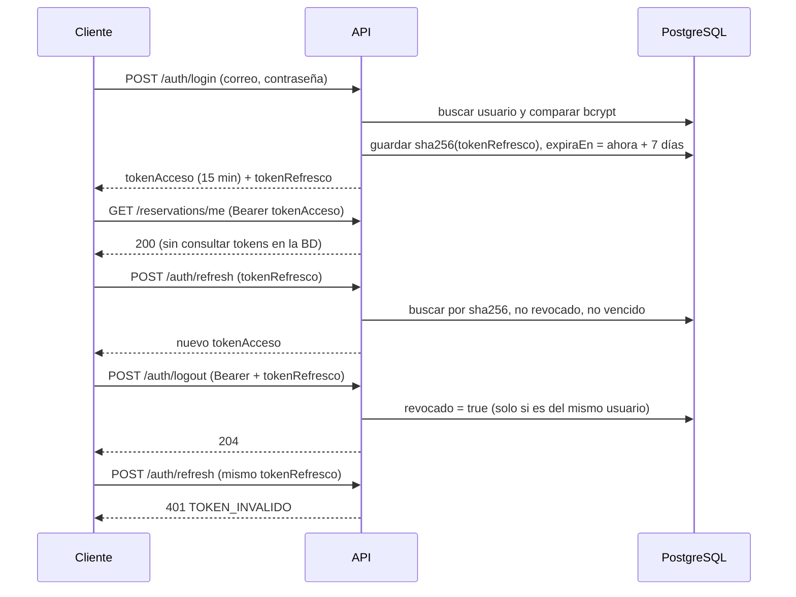

# ADR 0003 — JWT de acceso de 15 min y token de refresco opaco de 7 días

## Estado

Aceptado.

## Contexto

La API la consumen una interfaz web y una CLI, y tiene que saber en cada solicitud **quién** llama y **con qué
rol** (administrador, docente o estudiante). Además:

- Validar cada solicitud debe ser rápido y no depender de una consulta a la base de datos.
- Se debe poder **cerrar sesión de verdad** (RF-04): después del logout, el token ya no sirve para obtener
  nuevos accesos.
- Si alguien obtiene la base de datos, no debe poder usar los tokens guardados ahí.
- La API debe ser sin estado (*stateless*) para poder escalar en el futuro.

## Decisión

Usar **dos tokens**:

1. **Token de acceso (JWT)**: firmado con HS256 y `SECRETO_JWT`, contiene `{ sub: id, rol }` y **dura 15 minutos**
   (`DURACION_TOKEN_ACCESO`). Se envía como `Authorization: Bearer <token>`. El middleware `autenticarJwt`
   lo verifica sin tocar la base de datos.
2. **Token de refresco opaco**: 48 bytes aleatorios (`randomBytes(48)`, 96 caracteres hexadecimales), **dura
   7 días** (`DIAS_TOKEN_REFRESCO`). En la tabla `tokens_refresco` se guarda **solo su hash SHA-256**, con
   `expiraEn` y `revocado`.

Flujo:

## Alternativas descartadas

| Alternativa | Motivo del descarte |
|---|---|
| **Sesiones en el servidor** (cookie + sesión en Redis o en la BD) | Cada solicitud necesitaría una consulta para validar la sesión. Las cookies además complican la CLI y piden protección contra CSRF. |
| **Un solo JWT de larga duración** (por ejemplo 7 días) | No se puede revocar: un token robado o de una sesión cerrada sigue sirviendo hasta que vence. No cumple RF-04. |
| **Token de refresco también como JWT** | Sigue sin poder revocarse sin guardarlo en la BD, y si de todas formas se guarda, la firma no aporta nada frente a un valor aleatorio. Además, sería más largo y expondría su contenido. |
| **Guardar el token de refresco en texto plano** | Quien lea la base de datos (un respaldo filtrado, por ejemplo) podría usar los tokens. Con SHA-256 basta, porque el token es aleatorio y largo; no hace falta bcrypt, que además impediría buscarlo por índice. |

## Consecuencias

**Positivas**

- Validar el token de acceso es rápido y no consulta la base de datos.
- El logout es real: el token de refresco revocado da 401 TOKEN_INVALIDO (lo comprueba la prueba de
  integración `pruebas/autenticacion/flujoAutenticacion.prueba.ts`).
- Un respaldo filtrado de la base de datos no expone tokens utilizables.
- Al refrescar se lee el rol actual del usuario, así que un cambio de rol se aplica en máximo 15 minutos.

**Negativas**

- Un token de acceso robado sirve hasta por 15 minutos aunque se haga logout (no hay lista negra de JWT).
- El cliente debe manejar dos tokens y pedir uno nuevo cuando el de acceso vence.
- La tabla `tokens_refresco` crece con cada login; los tokens vencidos o revocados no se borran solos
  (se podría agregar una limpieza periódica).
- Si `SECRETO_JWT` se filtra, se pueden falsificar tokens de acceso; hay que cambiarlo y eso cierra todas las sesiones.
