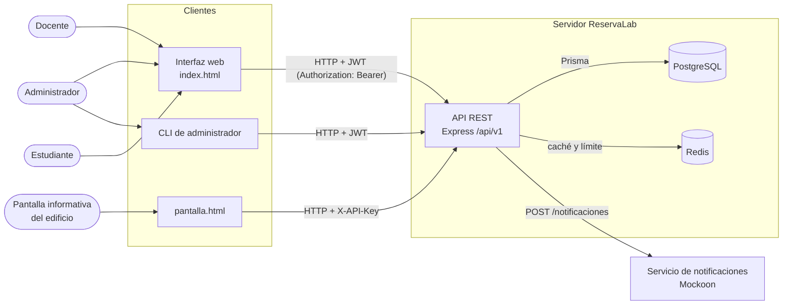

# 1. Contexto y requisitos

## 1.1 Problema

La facultad tiene laboratorios y salones que comparten docentes de distintos cursos. Por ejemplo, el
**edificio D** tiene 9 laboratorios: Electrónica, Telecomunicaciones, Electricidad, Física, Civil,
Computación 1, 2 y 3, y Dibujo. Hoy las reservas se
coordinan de forma manual (mensajes, hojas de cálculo o directamente con la secretaría). Esto provoca:

- **Choques de horario**: dos docentes reservan el mismo espacio a la misma hora.
- **Poca visibilidad**: no hay un lugar único para consultar qué espacios están libres en un día.
- **Sin información en el edificio**: quien llega al edificio no sabe qué espacio está ocupado en ese momento.
- **Sin control de acceso**: cualquiera puede apartar o cancelar un espacio.

**ReservaLab** es un sistema cliente-servidor que centraliza los espacios y sus reservas. Una API REST
aplica las reglas de negocio (por ejemplo, que no haya dos reservas traslapadas) y la consumen una interfaz
web, una pantalla informativa y una CLI de administración.

## 1.2 Tipos de usuario

| Usuario | Cómo se identifica | Qué puede hacer |
|---|---|---|
| **Administrador** | JWT (correo y contraseña) | Todo lo del docente; además crea, edita y desactiva espacios, cancela cualquier reserva y administra las llaves API (desde la web o la CLI). |
| **Docente** | JWT (correo y contraseña) | Consulta espacios y disponibilidad, crea reservas y cancela las suyas. |
| **Estudiante** | JWT (se registra solo) | Consulta espacios y disponibilidad. **No** puede reservar (403). |
| **Pantalla informativa** | Llave API en `X-API-Key` (sin usuario) | Sistema externo colocado en el edificio. Consulta la ocupación actual (`GET /now`) y los espacios, solo con los permisos de su llave (`read:now`, `read:spaces`) y con un límite de solicitudes por minuto. |

## 1.3 Requisitos funcionales

Todas las rutas están bajo `/api/v1` y responden JSON.

| RF | Método y ruta | Descripción | Quién |
|---|---|---|---|
| RF-01 | `POST /auth/register` | Registrar un usuario nuevo (siempre con rol estudiante). 409 si el correo ya existe. | Público |
| RF-02 | `POST /auth/login` | Iniciar sesión: devuelve un token de acceso (JWT) y un token de refresco. | Público |
| RF-03 | `POST /auth/refresh` | Obtener un nuevo token de acceso con un token de refresco válido. | Público |
| RF-04 | `POST /auth/logout` | Cerrar sesión: revoca el token de refresco del usuario autenticado. | Autenticado |
| RF-05 | `GET /spaces` | Listar espacios activos, con filtros `edificio` y `capacidadMinima`. Con caché (`X-Cache`). | JWT o llave `read:spaces` |
| RF-06 | `POST/PATCH/DELETE /spaces` | Crear, editar y desactivar espacios. | Administrador |
| RF-07 | `GET /spaces/:id/availability?date=` | Bloques de 60 min libres u ocupados de un espacio en un día. Con caché. | JWT o llave `read:spaces` |
| RF-08 | `POST /reservations` | Crear una reserva dentro del horario del espacio y sin traslapes (409 `TRASLAPE`). | Docente, administrador |
| RF-09 | `GET /reservations/me` | Listar mis reservas con los datos del espacio. | Autenticado |
| RF-10 | `DELETE /reservations/:id` | Cancelar una reserva (solo su dueño o un administrador). | Autenticado |
| RF-11 | `GET /now` | Ocupación actual agrupada por edificio, para la pantalla informativa. Con caché y límite de solicitudes. | Llave `read:now` |
| RF-12 | `POST/GET/DELETE /api-keys` | Crear (se muestra una sola vez), listar y revocar llaves API. | Administrador |
| RF-13 | `GET /health` | Estado de la API, la base de datos y la caché (200 `ok` o 503 `degradado`). | Público |

Además, `/docs` muestra la documentación OpenAPI con Swagger UI.

## 1.4 Restricciones

- Monorepo con pnpm 9 y Turborepo; TypeScript en todo el sistema.
- API con Express 5, Prisma 6 sobre PostgreSQL 16 y Redis 7.
- Servicio de notificaciones simulado con Mockoon.
- Todo se levanta con un solo `docker compose up --build`.
- Horario de Guatemala (UTC−6, sin horario de verano).

## 1.5 Diagrama de contexto

Los clientes nunca hablan con la base de datos ni con Redis: todo pasa por la API, que es la única que
aplica las reglas de negocio y de seguridad.
