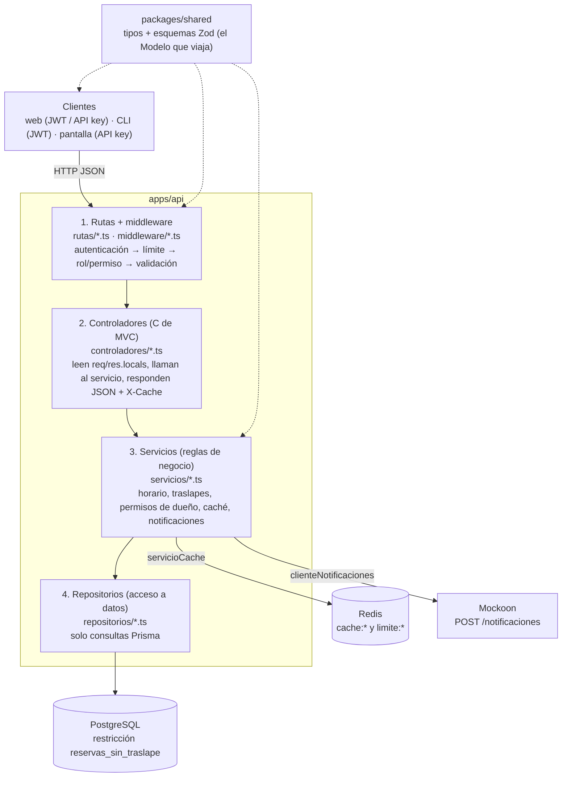

# 02 — Vista lógica: capas y MVC

ReservaLab es una API cliente-servidor. Dentro de `apps/api` cada solicitud atraviesa **cuatro capas en orden**, y ninguna se salta a la siguiente. Los clientes (`apps/web` y `apps/cli`) no tienen reglas de negocio: solo consumen la API. Los tres paquetes comparten tipos y esquemas Zod desde `packages/shared`.

## Diagrama de capas

## Qué va en cada capa

| Capa | Responsabilidad | Puede | No puede | Archivos (espacios y reservas) |
|---|---|---|---|---|
| Rutas | Encadenar middleware y controlador | usar `validar`, `autenticarJwt`, `requerirRol`, `autenticarJwtOApiKey` | tener lógica | `rutasEspacios.ts`, `rutasReservas.ts` |
| Controladores | Traducir HTTP ↔ servicio | leer `req.usuario` y `res.locals.*`, poner `X-Cache`, elegir código HTTP | importar `prisma` | `controladorEspacios.ts`, `controladorReservas.ts` |
| Servicios | Reglas de negocio | lanzar `ErrorAplicacion`, usar caché, enviar notificaciones | tocar `req` o `res` | `servicioEspacios.ts`, `servicioDisponibilidad.ts`, `servicioReservas.ts`, `servicioCache.ts` |
| Repositorios | Consultas a la base de datos | usar `prisma`, traducir errores de BD (23P01 → 409) | conocer HTTP | `repositorioEspacios.ts`, `repositorioReservas.ts` |
| Clientes externos | Hablar con otros servicios | `fetch` con tiempo máximo | romper la solicitud si fallan | `clienteNotificaciones.ts` |

## Cómo se aplica MVC

- **Modelo**: `schema.prisma` (persistencia) y los tipos de `@reservalab/shared` (`Espacio`, `Reserva`, `Disponibilidad`), que son lo que la API devuelve.
- **Vista**: la respuesta JSON. La API no genera HTML; la vista "visual" la construyen `apps/web` y `apps/cli`.
- **Controlador**: los archivos de `controladores/`. Son delgados: una llamada al servicio y una respuesta.

## Ejemplo: RF-08 crear reserva atravesando las capas

1. `rutasReservas.ts`: `autenticarJwt` → `requerirRol('docente','administrador')` → `validar(esquemaCrearReserva)`.
2. `controladorReservas.crear`: toma `req.usuario.id` y `res.locals.cuerpo`, llama a `servicioReservas.crear`, responde `201`.
3. `servicioReservas.crear`: espacio activo (404) → horario (400) → traslape (409) → crear → invalidar caché → notificar.
4. `repositorioReservas.crear`: `prisma.reserva.create`; si PostgreSQL responde 23P01 lanza `ErrorAplicacion(409, 'TRASLAPE')`.

## Cómo se verifica

- Ningún archivo de `controladores/` importa `config/baseDatos`.
- Ningún archivo de `repositorios/` ni `servicios/` usa `req` o `res`.
- Las pruebas unitarias de `servicioReservas` simulan los repositorios con `vi.mock`, lo cual solo es posible porque las capas están separadas.
