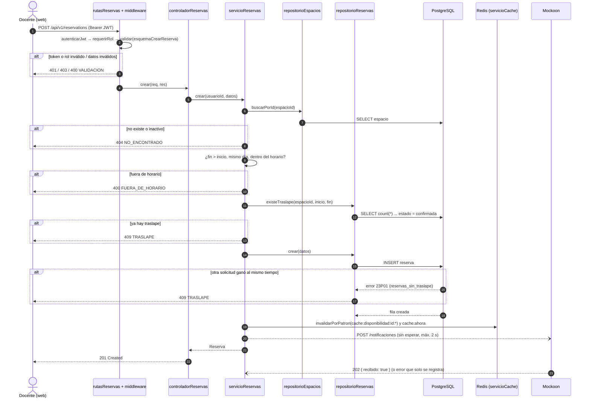
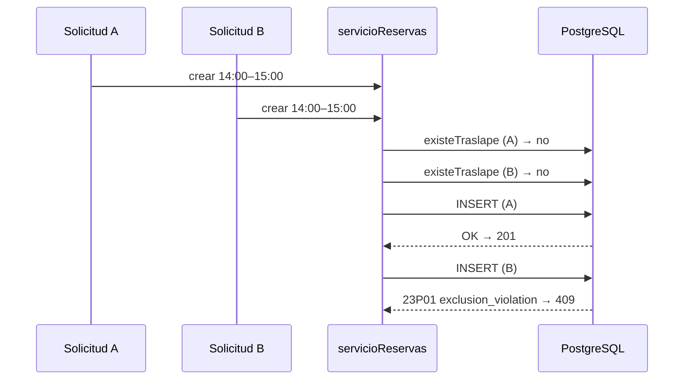
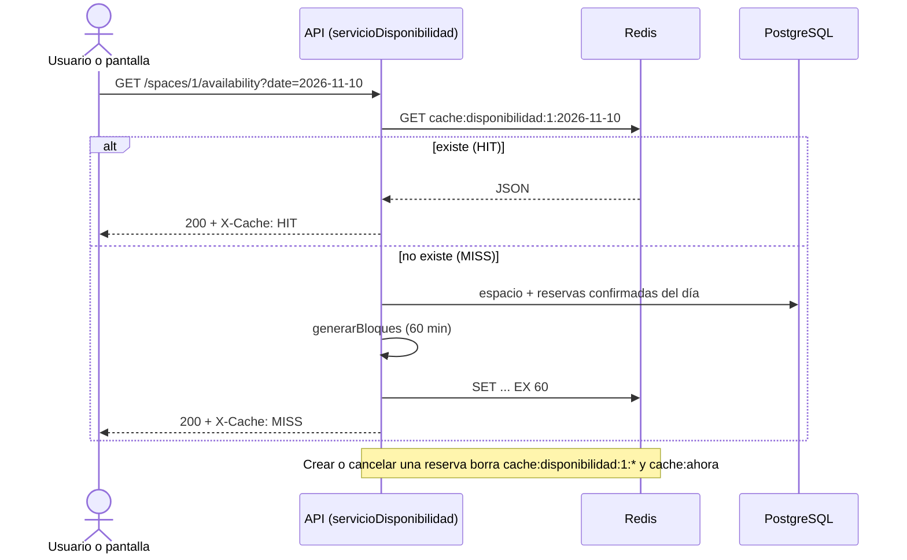

# 03 — Vista de procesos

Esta vista muestra qué pasa en el tiempo cuando llegan solicitudes, en especial la creación de una reserva, que es el flujo con la regla de negocio más importante (no hay dos reservas traslapadas).

## Crear reserva (RF-08)

## Dos solicitudes al mismo tiempo

La validación en el servicio da mensajes claros en el caso normal; la restricción de exclusión en la base de datos garantiza la regla cuando dos procesos pasan la validación al mismo tiempo (ver ADR 0004).

## Consultar disponibilidad con caché (RF-07)

## Procesos y concurrencia

| Proceso | Contenedor | Concurrencia |
|---|---|---|
| API (Node.js + Express 5) | `api` | Un proceso con event loop; atiende muchas solicitudes a la vez con E/S asíncrona |
| PostgreSQL | `basedatos` | Serializa los INSERT en conflicto mediante la restricción de exclusión |
| Redis | `cache` | Un hilo; `GET`/`SET`/`SCAN` atómicos |
| Mockoon | `notificaciones` | Independiente; si falla, la API sigue |
