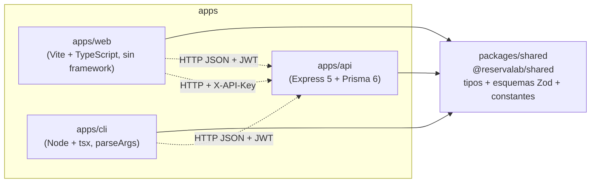

# 4. Vista de desarrollo — Monorepo

ReservaLab es un monorepo con **pnpm workspaces** y **Turborepo**. Hay tres aplicaciones y un paquete compartido. Las aplicaciones nunca se importan entre sí: todo lo común pasa por `@reservalab/shared`.

## Diagrama de paquetes

Las flechas sólidas son dependencias de código (`import ... from '@reservalab/shared'`); las punteadas son llamadas HTTP en tiempo de ejecución.

## Qué contiene cada paquete

| Paquete | Contenido | Depende de |
|---|---|---|
| `packages/shared` | Constantes (`PREFIJO_API`, `PREFIJO_LLAVE`, `ZONA_HORARIA`), enumeraciones (`ROLES`, `PERMISOS`), esquemas Zod (`esquemaCrearReserva`, `esquemaCrearLlaveApi`…) y tipos de respuesta (`Espacio`, `RespuestaAhora`, `LlaveApiCreada`…) | `zod` |
| `apps/api` | API REST en capas: rutas → controladores → servicios → repositorios. Middleware de JWT, roles, llaves API, permisos y límite de solicitudes | `shared`, Express, Prisma, ioredis |
| `apps/web` | `index.html` (inicio de sesión + reservas) y `pantalla.html` (ocupación con llave API). Código en `src/` | `shared`, Vite |
| `apps/cli` | Herramienta de administrador: `crear-espacio`, `crear-llave`, `listar-llaves`, `revocar-llave` | `shared`, tsx |

## Por qué un paquete compartido

- **Un solo contrato**: si cambia `esquemaCrearLlaveApi`, la API (que valida con `validar(...)`) y el CLI (que valida antes de enviar) cambian juntos y `pnpm typecheck` avisa en los tres.
- **Validación en el cliente con las mismas reglas**: el CLI rechaza `--permisos write:todo` sin llamar a la API.
- **Tipos de respuesta**: la web usa `Disponibilidad` y `RespuestaAhora`; si la API cambia la forma de la respuesta, la web deja de compilar.

## Tareas de Turborepo

| Comando (raíz) | Qué hace |
|---|---|
| `pnpm dev` | `turbo dev`: API (`tsx watch`) y web (`vite`) a la vez |
| `pnpm typecheck` | `tsc --noEmit` en cada paquete |
| `pnpm test` | Vitest + Supertest de la API con cobertura |
| `pnpm servicios` | Levanta solo PostgreSQL, Redis y Mockoon con Docker |
| `pnpm --filter cli cli <comando>` | Ejecuta el CLI |

## Configuración

Un solo `.env` en la raíz. La API lo lee con `dotenv-cli` y lo expone en el objeto `entorno`; la web solo ve variables `VITE_*` (`envDir: '../../'`); el CLI usa `URL_API`.

## Convenciones

Identificadores en español sin tildes ni ñ, archivos en camelCase, pruebas `*.prueba.ts` en `apps/api/pruebas/<modulo>/` y Conventional Commits con ámbitos por integrante (`llaves`, `ahora`, `web`, `cli`, `docs` para la Integrante C).
