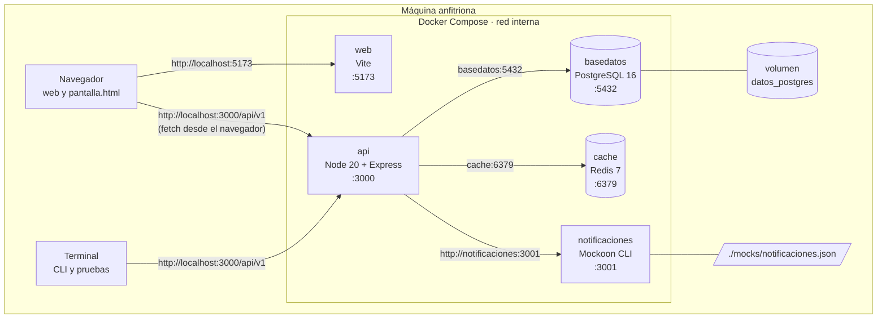
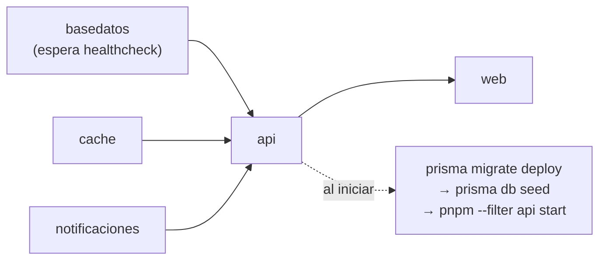

# 5. Vista física: despliegue

## 5.1 Contenedores

El sistema completo se levanta con Docker Compose (`docker-compose.yml` en la raíz) y tiene 5 contenedores:

| Servicio | Imagen | Puerto (host:contenedor) | Para qué |
|---|---|---|---|
| `basedatos` | `postgres:16-alpine` | 5432:5432 | PostgreSQL. Los datos viven en el volumen `datos_postgres`. Tiene `healthcheck` con `pg_isready`. |
| `cache` | `redis:7-alpine` | 6379:6379 | Caché de respuestas (TTL 60 s) y contadores del límite de solicitudes. |
| `notificaciones` | `mockoon/cli:latest` | 3001:3001 | Servicio de notificaciones simulado. Lee `mocks/notificaciones.json` (montado de solo lectura). |
| `api` | build de `apps/api/Dockerfile` | 3000:3000 | La API REST y `/docs`. Al arrancar aplica las migraciones, carga la semilla y levanta Express. |
| `web` | build de `apps/web/Dockerfile` | 5173:5173 | Servidor de Vite con `index.html` y `pantalla.html`. |

## 5.2 Diagrama de despliegue

Notas:

- El contenedor `web` solo sirve los archivos. El JavaScript corre en el **navegador**, así que las llamadas a
  la API salen del navegador hacia `localhost:3000` (por eso la API habilita CORS para `ORIGEN_WEB`).
- Dentro de la red de Compose los contenedores se encuentran por su **nombre de servicio**
  (`basedatos`, `cache`, `notificaciones`), no por `localhost`.

## 5.3 Orden de arranque

- `api` espera a que `basedatos` esté **sano** (`condition: service_healthy`) y a que `cache` y
  `notificaciones` hayan iniciado.
- `web` espera a que `api` haya iniciado.
- La semilla es idempotente (`upsert`), así que reiniciar la API no duplica datos.

## 5.4 Manejo del `.env`

Hay **un solo `.env` en la raíz** para todo (API, web, CLI y Docker):

1. En el repositorio solo está `.env.example`. El `.env` real está en `.gitignore` y **nunca se sube**.
2. Cada persona lo crea con `cp .env.example .env` y, como mínimo, cambia `SECRETO_JWT`.
3. Quién lo lee:

| Quién | Cómo lo lee |
|---|---|
| Contenedores `basedatos`, `api`, `web` | `env_file: .env` en `docker-compose.yml` |
| API en desarrollo y pruebas | `dotenv -e ../../.env` en los scripts de `apps/api/package.json` |
| Web (Vite) | `envDir: '../../'`; solo expone al navegador las variables que empiezan con `VITE_` |
| CLI | `dotenv -e ../../.env` (usa `URL_API`) |

4. **Mismo archivo, dos entornos.** El `.env` trae los hosts para desarrollo local (`localhost`). Dentro de
   Docker esos hosts no sirven, por eso el servicio `api` **sobrescribe** tres variables en
   `docker-compose.yml`:

| Variable | Desarrollo local (`.env`) | Dentro de Docker (`environment:`) |
|---|---|---|
| `URL_BASE_DATOS` | `postgresql://…@localhost:5432/reservalab` | `postgresql://…@basedatos:5432/reservalab` |
| `URL_REDIS` | `redis://localhost:6379` | `redis://cache:6379` |
| `URL_NOTIFICACIONES` | `http://localhost:3001` | `http://notificaciones:3001` |

5. En el código nadie lee `process.env` directamente: todo pasa por el objeto `entorno`
   (`apps/api/src/config/entorno.ts`), que **falla al arrancar** si falta una variable obligatoria.

## 5.5 Dos formas de ejecutar

| Modo | Comando | Qué levanta |
|---|---|---|
| Entrega / demostración | `docker compose up --build` | Los 5 contenedores |
| Desarrollo | `pnpm servicios` y luego `pnpm --filter api dev` | Solo `basedatos`, `cache` y `notificaciones` en Docker; la API corre en la máquina con recarga automática |
